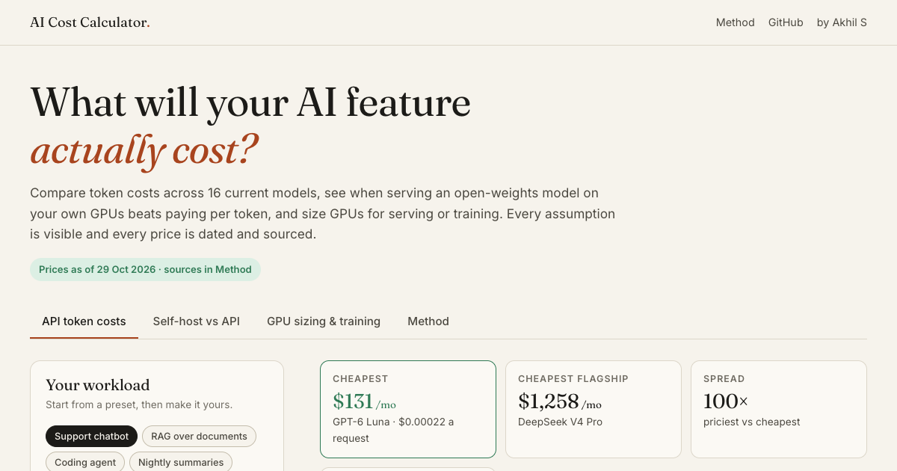

# AI Cost Calculator

**Live:** https://akhil743.github.io/gpu-cost-calculator/



Three questions come up whenever a team ships an AI feature: what will the API bill be, when does running an
open-weights model on our own GPUs become cheaper, and how much hardware does a model need? This calculator answers
all three from one engine and one dated price list, with every assumption on the page.

## What it does

**API token costs.** 16 current models from OpenAI, Anthropic, Google and open-weights hosts, priced for your
workload: requests per day, input and output tokens, the share of input served from cache, and the share sent through
batch APIs. It shows monthly cost, cost per request and per user, and where the money goes (fresh input, cached input,
output). Workload presets cover a support chatbot, RAG, a coding agent, nightly batch jobs and
[YouTube Chat AI](https://akhilrajs.com/youtube-chat/).

**Self-host vs API.** Pick an open-weights model, precision, GPU and price. It works out how many GPUs a replica
needs, decode throughput, cost per million output tokens and per request, and the request volume where self-hosting
starts to beat the API, with a cost-vs-traffic chart.

**GPU sizing and training.** Memory to serve a model (weights plus KV cache) on each GPU, and training compute, GPU-hours,
cost and wall-clock time from the 6·N·D rule.

## How the estimates work

- **Token costs:** fresh input × input price + cached input × cached price + output × output price, with batch prices
  for the batched share and long-context prices where the provider publishes them.
- **Serving throughput:** decoding is memory-bandwidth bound. A step reads the weights the batch touches plus every
  sequence's KV cache; the slower of that and the compute time sets tokens per second. KV cache per token comes from each
  model's published config (layers × KV heads × head size). Mixture-of-experts models read only the experts a batch
  touches.
- **Self-host cost:** whole replicas billed by the hour with one always on, divided by average utilisation, plus an
  optional ops overhead. Break-even is the volume where the API bill reaches one replica's monthly cost.
- **Training:** FLOPs = 6 × active parameters × tokens; GPU-hours = FLOPs ÷ (peak BF16 FLOPS × MFU).

**Calibration:** Llama 3.1 405B trained on 15.6T tokens. At 35% MFU on H100s the calculator gives 30.4M GPU-hours;
Meta reported 30.84M. This is checked by a unit test.

These are first-order estimates. Production serving stacks (vLLM, TensorRT-LLM, SGLang) add continuous batching,
speculative decoding and prefix caching, so measure your own workload before committing to hardware.

## Data

All prices and specs live in [`js/data.js`](js/data.js), each with its source:

| What | Source | As of |
| --- | --- | --- |
| OpenAI, Anthropic, Google token prices | Each provider's official API pricing page | 29 Oct 2026 |
| Open-weights hosted prices | Together AI pricing | 29 Oct 2026 |
| GPU on-demand prices | Lambda and RunPod pricing pages | 29 Oct 2026 |
| GPU specs (dense BF16/FP8 TFLOPS, memory, bandwidth) | NVIDIA datasheets | — |

Gemini 4 Argon and Gemini 3.8 Flash have announced price rises (1 Dec 2026 and 1 Jan 2027); the page flags them.
Updating prices is a one-file change: edit the numbers, update `asOf`, run the tests.

## Run it

It's a static site with no build step and no dependencies.

```bash
python3 -m http.server 8000   # then open http://localhost:8000
npm test                      # unit tests for the cost engine (Node 20+)
```

## Code

- `js/data.js`: prices, GPU specs, open-weights model configs and workload presets.
- `js/engine.js`: the maths as pure functions, shared by the page and the tests.
- `js/ui.js`: inputs, results, charts and shareable links (the scenario is saved in the URL).
- `tests/engine.test.js`: cost maths, memory sizing, break-even logic and the Llama 3.1 calibration.

Built by [Akhil S](https://akhilrajs.com). Estimates, not quotes. MIT licence.
